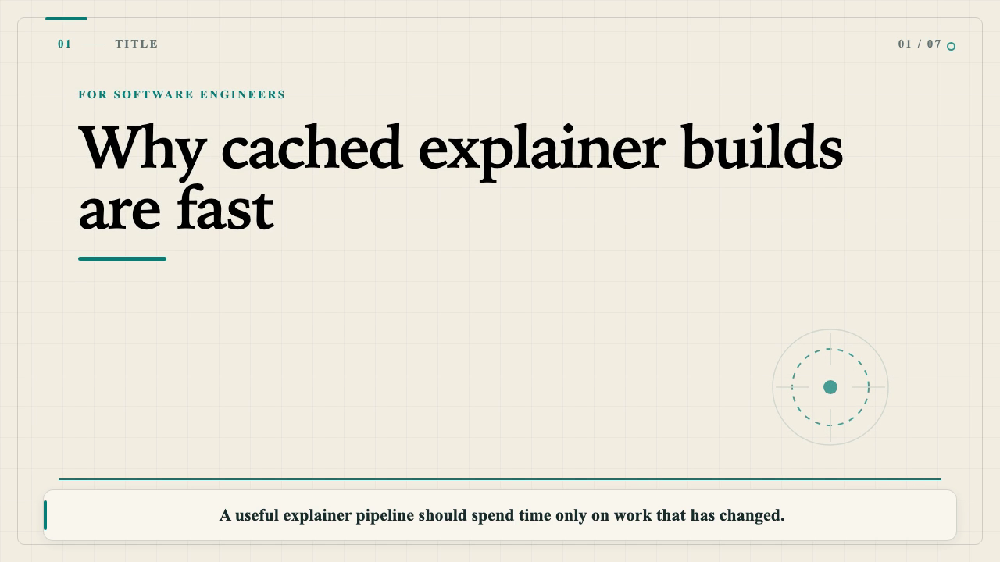

# Explain-to-Me

**Turn local documents into narrated, captioned explainer videos.**

Explain-to-Me combines local narration with deterministic diagrams, code cards and other explanatory scenes. Start from a reviewed manifest, or let a local model turn Markdown/plain text into a constrained production plan. The narration sets the timeline—not the other way around.

**macOS-first · TypeScript CLI · Local model adapters · MIT project code**

> Early preview software. Version 0.2 is prepared for review, not yet released. Only the 720p/24 fps preview profile and technical-whiteboard theme are implemented. See the [roadmap to 1.0](ROADMAP.md).



*Actual output from the bundled neutral caching example—not a mockup. Video/model artifacts are not bundled with the source.*

## What you can do today

- Build from Markdown, plain text or a prepared manifest.
- Choose local model direction or an explicitly extractive template fallback.
- Narrate with Apple speech or optional local Kokoro voices.
- Override pronunciations without changing visible captions or code.
- Render diagrams, comparisons, bullets, code, approved local images and title/outro scenes.
- Export captions timed from measured sentence/phrase audio chunks.
- Reuse direction, speech and rendered frames through persistent caches.
- Inspect media validation, timings, source references and provenance.

```text
Local source → constrained manifest → narration → measured timeline → video + captions
```

## Quickstart: your first video

The first example uses a prepared manifest and the installed Apple voice: **no separate LLM or Kokoro model setup is required.** Commands run from the repository root.

### 1. Install prerequisites

- macOS, Node.js 24+ with npm, Git, and FFmpeg/ffprobe.
- The macOS Samantha voice, available through Apple speech. Run `say -v '?'` to check installed voices.
- A rendering browser, downloaded explicitly in step 2.

If you use Homebrew, FFmpeg is available with `brew install ffmpeg`. Optional model requirements are separate below.

### 2. Set up the checkout

```bash
git clone https://github.com/TommyAllsup/explain-to-me.git
cd explain-to-me

# Setup may download the pinned pnpm launcher and dependencies.
npm exec --cache .cache/npm --yes --package=pnpm@10.18.3 -- pnpm install --frozen-lockfile

# One-time browser download; builds do not fetch it automatically.
node --input-type=module -e 'import {ensureBrowser} from "@remotion/renderer"; await ensureBrowser({chromeMode:"headless-shell"});'
```

A global pnpm or bundled Corepack is not required. The first command caches the pinned launcher in `.cache/npm`. The `--offline` commands below fail if that launcher is missing rather than fetching it during execution.

### 3. Diagnose and build

```bash
npm exec --cache .cache/npm --offline --yes --package=pnpm@10.18.3 -- pnpm explain-to-me doctor

npm exec --cache .cache/npm --offline --yes --package=pnpm@10.18.3 -- pnpm explain-to-me build \
  --manifest fixtures/golden-manifests/whisper-vs-tts.json \
  --tts apple --voice Samantha --duration 60s --output out/my-first-explainer

open out/my-first-explainer/video.mp4
```

Use a **new output directory** for each build; existing targets are refused. Doctor reports missing prerequisites and setup remedies. Optional model backends need not be installed for this first build. Source archives contain neither dependencies/models nor generated videos.

## Explain your own document

For local model direction, install llama.cpp so `llama-server` is available. The current adapter expects `/opt/homebrew/bin/llama-server`; other installations are not yet supported automatically. Kokoro setup also requires Python 3 and `uv` and creates an isolated Python 3.11 environment.

```bash
# Optional setup only: downloads pinned model/runtime assets.
python3 scripts/setup-director.py
python3 scripts/setup-kokoro.py

npm exec --cache .cache/npm --offline --yes --package=pnpm@10.18.3 -- pnpm explain-to-me build \
  fixtures/inputs/cached-builds/document.md \
  --director local --tts kokoro --voice af_heart --duration 60s \
  --audience "software engineers" \
  --pronunciations fixtures/inputs/cached-builds/pronunciations.json \
  --output out/my-document-explainer
```

Replace the fixture with your local `.md` or `.txt` file. Markdown accepts headings, paragraphs, lists, fenced code and bounded local PNG/JPEG/WebP references. Code and HTML are inert; arbitrary web pages are not inputs.

| Option | Behavior |
|---|---|
| `--director auto` | Use the local model when ready; explicitly report extractive fallback when necessary. |
| `--director local` | Require the installed local director; fail rather than silently use a cloud/subscription API or template. |
| `--director template` | Select source material deterministically; this is not semantic summarization. |
| `--tts auto` | Prefer installed Kokoro, otherwise explicitly fall back to Apple speech. |
| `--tts apple` / `--tts kokoro` | Require the selected backend. |
| `--pronunciations map.json` | Literal spoken substitutions, such as `{"PCM":"P C M"}`; visible text stays intact. |
| `--cache-dir path` | Override `.explain-to-me/cache`. |
| `--audience` / `--style` | Guide narration/direction, not arbitrary renderer code or new visual themes. |

Use `pnpm explain-to-me --help` or `pnpm explain-to-me --version` through the cached launcher above. The CLI is run from source; no global executable or npm publication is provided.

## Outputs and revisions

| Artifact | Contents |
|---|---|
| `video.mp4` / `audio.wav` | Muxed video and narration audio. |
| `captions.vtt` / `captions.srt` | Captions aligned to measured narration chunks. |
| `manifest.json` | Validated production intent. |
| `report.json` | Automated checks, timings, cache state, resolved assets and provenance. |

Approved images are copied beside the manifest in `assets/`; supporting scene samples may also be present. Rebuild a saved manifest with `--manifest` to retain the script instead of directing the document again. Exact reproduction requires the full build record and pinned environment, not the manifest alone. Independent cold TTS is not promised to be bit-identical.

Unchanged warm builds can reuse expensive work, but still mux and validate output. Separate concurrent cold builds may duplicate work; cross-process deduplication is not promised.

## Troubleshooting

- **Missing browser:** complete the explicit Headless Shell setup. Builds never download a browser.
- **Duration cannot be reached:** review the measured attempts. Add reviewed narration or request less time for a short script; shorten a long script or allow more time. Changing a document's requested duration may change its selected script; use a saved manifest to keep narration fixed. Speech is never truncated or padded to force a match.
- **Temporary socket path too long:** 0.2 uses shorter private names. An extremely long inherited `TMPDIR` can still fail; choose a shorter user-owned temporary root for that invocation. Private transport is never replaced with a shared socket or TCP fallback.
- **Build failed:** diagnostics remain in a staging directory. Review/redact source text and personal paths before sharing logs.

## Boundaries and honest limits

Setup deliberately downloads dependencies, the browser and optional models. Runtime model inference uses a private Unix socket; renderer requests are restricted/audited. **Whole-process no-egress verification remains open.** Local-first is not a completed security certification.

Model output is constrained manifest data, not executable React or shell commands. Image references are canonicalized within approved roots, bounded, copied and hash-checked. These controls are not a sandbox guarantee; see [security guidance](SECURITY.md).

Automated media/timing/caption checks do not approve accuracy, naturalness or pacing. Review your script and watch/listen to the output. Source mappings help inspection but do not prove generated claims. Captions are sentence/phrase timed, not word-aligned.

Custom cartoons, imported music, per-sentence pacing, ASR/listening review, PDF input, 1080p output and a Studio UI are **not built-in 0.2 features**. See [ROADMAP.md](ROADMAP.md) for proposed sequencing.

## Development and evidence

Start with [CONTRIBUTING.md](CONTRIBUTING.md) for checks and small-change guidelines. Linux CI covers typechecking/unit tests, not macOS speech or end-to-end media. Adding a workflow is not evidence that remote CI has run.

- [Changelog](CHANGELOG.md) · [0.2 release preview](docs/releases/0.2.0.md)
- [0.2 verification evidence](docs/benchmarks/0.2-readiness.md)
- [System boundaries](docs/architecture/0001-system-boundaries.md) · [Renderer decision](docs/architecture/0002-renderer-selection.md)
- [Milestone 1](docs/benchmarks/milestone-1-results.md) · [Phase 2](docs/benchmarks/phase-2-results.md) · [Phase 3](docs/benchmarks/phase-3-results.md) measurements
- [Acceptance contract and targets](docs/benchmarks/acceptance.md)

Historical reports retain their original scope and limitations; they are not blanket 0.2 acceptance or universal performance claims.

## License

Created by **Tommy Allsup**. Project code is [MIT-licensed](LICENSE).

Remotion, model weights, voice packs, browsers and other dependencies/assets retain their own terms. MIT licensing this project does not waive those terms or establish commercial-use clearance. Read [THIRD_PARTY_NOTICES.md](THIRD_PARTY_NOTICES.md) before redistribution or commercial deployment.

`private: true` in package metadata prevents accidental npm publication; it is separate from GitHub repository visibility. The repository remains private while this release is under owner review.
