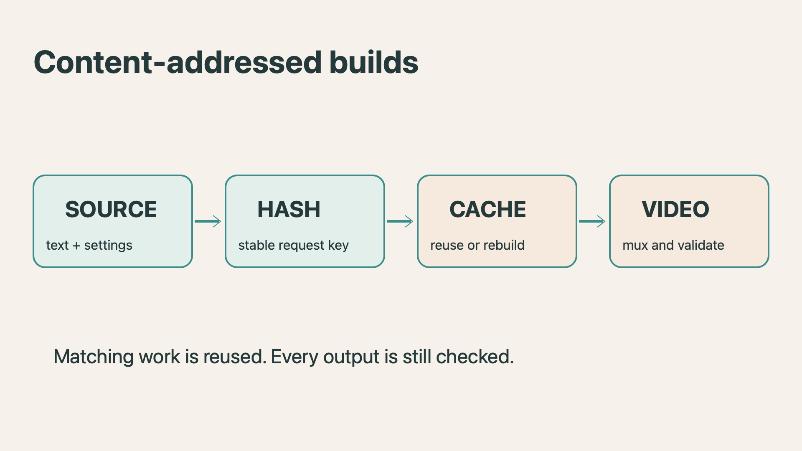

# Why cached explainer builds are fast

A useful explainer pipeline should spend time only on work that has changed. This project uses content-addressed caching to reuse narration and rendered video while still checking every published result. The cache is an optimization, not permission to skip validation.

## A request becomes a stable key

Each cache key identifies a stage and its relevant inputs. A narration request includes the words, voice, speaking speed, model identity, and runtime configuration. Canonical JSON sorts object properties before SHA256 hashing, so rearranging property order does not create a different request.



The diagram is an illustration supplied with this document. It is not a screenshot of a cloud service.

## Reuse the expensive stages

- An unchanged request reuses its measured narration samples.
- A matching render request reuses the already rendered video frames.
- Muxing and media validation still run for each output directory.
- A visual-only edit can preserve narration while requesting new frames.

The following example illustrates the lookup pattern. Production keys also include the model and runtime identity; the abbreviated example is not the complete production key.

```ts
const key = cache.key("example-narration", {
  text: sentence,
  voice: "af_heart",
  speed: 1,
});
const pcm = await cache.getOrCreate(key, synthesize);
```

## Treat cached bytes as checked data

Each stored entry contains both a payload digest and its request key. A damaged entry is a cache miss. Copying valid bytes under the wrong request key is rejected too. Atomic writes prevent readers from consuming an incomplete entry; private file permissions protect stored content.

## Know what must change

Changing the narrator or spoken words invalidates the corresponding audio requests. Changed audio duration also changes the timeline and can require new rendering. Changing an image or scene layout invalidates its visual dependencies. Choosing a different output folder does not, by itself, make the source or narration different.

## Keep the limits explicit

Factory deduplication is per cache instance, not a cross-process build lock. Two independent cold builds may still duplicate work. Sentence-level PCM boundaries define caption timing; they are not a claim of word-level alignment. Source code is shown as text and is never executed by the video pipeline.

The practical result is a quick repeat build with the same content, without hiding what was reused or skipping the checks that make the output usable.
